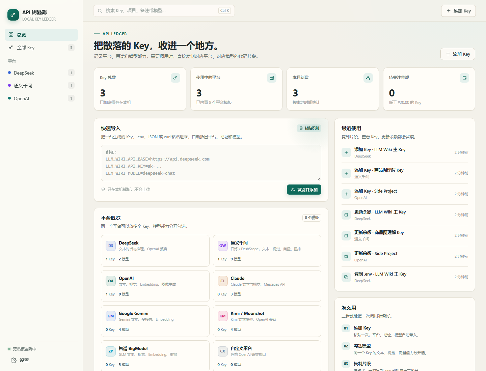
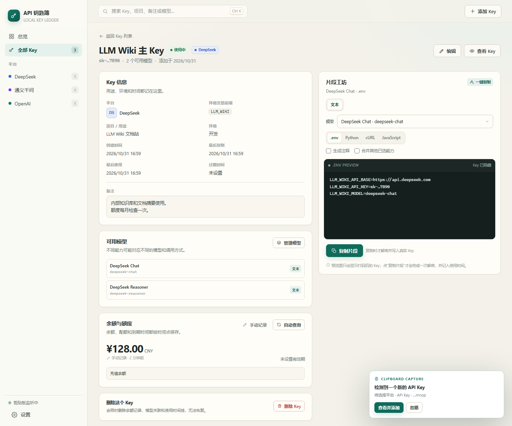

# API 钥匙簿

一个完全在本机运行的 API Key 台账：记录各平台的 Key、用途、模型能力、余额和时间，并一键生成可以直接复制的 `.env` 或调用代码。

> 目标不是替你把请求发出去，而是让你在需要调用某个模型时，不用再翻平台文档、猜 base URL、找模型 ID。





---

## 快速开始

### 环境

- Windows 10 / 11
- **源码/浏览器版**：Python 3.11 或更高版本，不需要第三方包
- **打包后的桌面版**：目标电脑不需要 Python；需要 WebView2 Runtime（Windows 10/11 通常已自带）

### 启动（源码 / 浏览器版）

双击项目根目录的：

```text
启动工具.bat
```

它会：

1. 检查 Python 版本
2. 启动本地服务（默认 `http://127.0.0.1:8765/`）
3. 自动打开浏览器
4. 首次运行时创建 `data/ledger.db`

关闭启动窗口或按 `Ctrl+C` 即可停止。端口被占用时会自动往后找可用端口，控制台会打印实际地址。

也可以手动启动：

```bash
python app.py
python app.py --port 8800 --no-browser
```

### 桌面窗口版（打包后使用）

打包完成后双击：

```text
dist\APIKeyLedger\API钥匙簿.exe
```

- 打开独立窗口，不经过默认浏览器
- 关闭窗口即退出；设置页也有“退出程序”
- 数据保存在 exe 同目录的 `data\ledger.db`
- 整个 `dist\APIKeyLedger` 文件夹就是便携版，可以一起拷贝
- 不要放在 `Program Files`，否则普通账户可能没有写权限
- 如果端口 8765 被占用，会自动尝试后面的端口
- 源码版和便携版各用各的 `data`；迁移时把源码目录的 `data\ledger.db` 复制到 exe 同目录的 `data\`
- **发给别人前，先删除 `dist\APIKeyLedger\data`**，否则会把你的加密 Key 一起带过去
- `build_exe.bat` 在重新打包前会自动备份并恢复 `dist\APIKeyLedger\data`

未签名的 exe 首次运行可能被 SmartScreen 提示，个人自用点“更多信息 → 仍要运行”即可；要分发给别人，建议做代码签名。

### 单文件版

如果不想带 `_internal` 文件夹，可以双击：

```text
dist\API钥匙簿.exe
```

- 只有一个 exe（约 13 MB），不需要 `_internal`
- 数据放在 `%LOCALAPPDATA%\ApiKeyLedger\data\ledger.db`
- exe 可以单独移动；换位置不会丢数据
- 每次启动会先解压运行库，通常比文件夹版慢几秒
- 单文件版更容易被 SmartScreen/杀软误报
- 便携文件夹版和单文件版各自使用独立的 `data`，不要同时往两边录入

重新打包单文件版：

```text
build_onefile.bat
```

### 安装包（最接近普通桌面软件）

安装包输出：

```text
dist\installer\APIKeyLedger-1.1.0-setup.exe
```

安装包会：

- 安装到 `%LOCALAPPDATA%\Programs\ApiKeyLedger`，不需要管理员权限
- 创建开始菜单快捷方式，可选桌面快捷方式
- 带卸载程序
- 覆盖升级，不会删除 `%LOCALAPPDATA%\ApiKeyLedger\data`
- 卸载程序也不会删除用户数据

构建安装包（需要 Inno Setup 6）：

```text
winget install JRSoftware.InnoSetup
build_installer.bat
```

前提是已经执行过 `build_onefile.bat`，因为安装包使用单文件 exe 作为载荷。

### 发布新版本

版本号只有一个来源：`core/version.py`。

发版流程：

1. 修改版本号：
   ```bash
   python tools/set_version.py 1.1.0
   ```
2. 更新 `CHANGELOG.md`
3. 本地构建：
   ```text
   build_onefile.bat
   build_installer.bat
   ```
4. 提交并打 tag：
   ```bash
   git add .
   git commit -m "release v1.1.0"
   git tag v1.1.0
   git push origin main --tags
   ```
5. GitHub Actions 会自动：
   - 构建单文件版和便携文件夹版
   - 构建安装包
   - 生成 SHA256 校验文件
   - 发布到 GitHub Releases

工作流文件：`.github/workflows/release.yml`。用户从 Releases 下载 `setup.exe` 或单文件版即可；数据仍然在本机。

如果不想用 Actions，也可以手动把 `dist\release\` 里的文件上传到一个 GitHub Release：

```text
APIKeyLedger-1.1.0-onefile.exe
APIKeyLedger-1.1.0-portable.zip
APIKeyLedger-1.1.0-setup.exe
SHA256SUMS.txt
```

### 自己重新打包

需要 Python 3.11+。入口：

```text
build_exe.bat        # 便携文件夹版，输出 dist\APIKeyLedger\
build_onefile.bat    # 单文件版，输出 dist\API钥匙簿.exe
build_installer.bat  # 安装包，输出 dist\installer\APIKeyLedger-*-setup.exe
```

脚本会：

1. 创建或复用 `.venv`
2. 安装 `requirements-build.txt` 里的 PyInstaller / pywebview
3. 按对应的 `.spec` 打包
4. 文件夹版会自动备份/恢复 `dist\APIKeyLedger\data`
5. 安装包需要额外的 Inno Setup 6

打包后的程序是 `--windowed` 的，不显示控制台；启动错误会写入对应 `data\app.log`。

---

## 能做什么

### 1. 平台与 Key 台账

内置：

- DeepSeek
- 通义千问 / 百炼
- OpenAI
- Claude / Anthropic
- Google Gemini
- Kimi / Moonshot
- 智谱 BigModel
- 自定义 OpenAI 兼容平台

每个 Key 可以记录：

- 名称、平台、Key 掩码
- 环境变量前缀（例如 `LLM_WIKI`）
- 项目 / 用途
- 开发 / 测试 / 生产 / 个人
- 备注、过期时间
- 创建时间、最后复制时间、最后使用时间
- 该 Key 可用的模型

同一个平台可以存多个 Key，例如“日常用”和“项目专用”。

### 2. 粘贴导入

支持粘贴：

- `.env` 配置
- JSON
- curl 命令
- 单独的 API Key

例如把下面这段粘贴进去：

```env
LLM_WIKI_API_BASE=https://api.deepseek.com
LLM_WIKI_API_KEY=sk-xxxx
LLM_WIKI_MODEL=deepseek-chat
```

工具会自动识别出平台、Base URL、Key、前缀和模型，填好表单后再确认保存。

### 3. 模型能力分开管理

模型不只记录一个 ID，还记录调用方式：

- 文本对话
- 视觉 / 多模态
- 向量 Embedding
- 重排 Rerank
- 图像生成

所以同一个通义千问 Key 可以同时有：

- `qwen-plus`：文本对话
- `qwen-vl-max`：多模态
- `text-embedding-v4`：向量
- `gte-rerank-v2`：重排

片段工坊会按能力选择正确的模板：通义原生的向量、重排、多模态走 DashScope SDK，不会套错成 OpenAI 的调用方式。

### 4. 片段工坊

选择一个 Key、能力和模型，然后选择：

- `.env`
- Python
- cURL
- JavaScript

生成 `.env` 时，格式就是：

```env
LLM_WIKI_API_BASE=https://api.deepseek.com
LLM_WIKI_API_KEY=sk-xxxx
LLM_WIKI_MODEL=deepseek-chat
```

如果选择了多个能力，可以生成：

```env
LLM_WIKI_API_BASE=...
LLM_WIKI_API_KEY=...
LLM_WIKI_MODEL=qwen-plus
LLM_WIKI_VISION_MODEL=qwen-vl-max
LLM_WIKI_EMBEDDING_MODEL=text-embedding-v4
LLM_WIKI_RERANK_MODEL=gte-rerank-v2
```

代码片段默认从环境变量读取 Key，不把 Key 写进代码；需要一次性脚本时，可以在设置里打开“代码里直接写入 Key”。

预览只显示打码后的 Key。只有点击“复制片段”时才会解密一次，并写入使用时间。

### 5. 余额与额度

支持手动记录：

- 余额金额、币种
- 配额总量、已用、剩余、单位
- 到期时间
- 备注
- 历史快照

低余额提醒使用你选择的币种（默认 CNY），不会拿 USD 余额和 CNY 阈值直接比较。提醒线和币种都可以在设置里改。

支持自动查询的平台：

- DeepSeek：`/user/balance`
- Kimi / Moonshot：`/v1/users/me/balance`

其他平台（通义、OpenAI、Claude、Gemini、智谱）的普通 API Key 通常没有公开的余额查询接口，工具会标成“手动记录”，不会伪造数字。OpenAI 的账单接口需要 Admin Key，第一版没有接入。

### 6. 模型拉取

在“管理模型”里可以尝试从平台接口拉取当前模型列表：

- OpenAI 兼容平台：`/models`
- Anthropic：`/v1/models`
- Gemini：`/v1beta/models`

拉取失败不会影响已有模型；你仍然可以手动添加模型 ID、能力和调用方式。

### 7. 剪贴板监听

默认开启。复制到看起来像 API Key 的文本时，右下角会弹出提示，询问是否入库。

- 只识别 Key、`.env` 等疑似内容
- 不保存其他剪贴板文本
- 可以在设置里随时关闭
- 如果 Key 已经录入过，不会重复提示

### 8. 搜索、备份与导出

- 按 Key 名称、项目、备注、平台、模型搜索
- 下载 SQLite 数据库备份
- 导出 JSON（不含真实 Key）
- 打开数据文件夹

---

## 安全设计

- **本地服务**：只监听 `127.0.0.1`，不对外网开放。
- **Key 加密**：使用 Windows DPAPI，绑定当前 Windows 账户，不需要设置主密码。
- **掩码显示**：列表和预览只显示 `sk-…c516` 这样的尾部。
- **按需解密**：查看或复制时才解密，不写入日志。
- **CSRF 防护**：API 需要页面内的会话令牌，跨站请求会被拒绝。
- **不保存厂商账号密码**：工具不会自动登录各平台控制台。
- **不联网同步**：没有云端账号，没有遥测；只有你主动点击“拉取模型”或“自动查余额”时才会请求对应平台。

### 换电脑怎么办？

DPAPI 密文只能在同一台电脑、同一个 Windows 账户下解密。换电脑后：

- 重新录入 Key，或
- 在同一台电脑上先把 Key 手动导出/保存到别处，再在新机器录入

数据库备份适合“同一台电脑恢复”，不是跨机器迁移方案。

---

## 数据位置

默认：

```text
data/ledger.db
```

这个目录已加入 `.gitignore`。不要把 `data/ledger.db` 发给别人，也不要把包含真实 Key 的 `.env` 片段提交到代码仓库。

---

## 快捷键

| 快捷键 | 行为 |
|---|---|
| `Ctrl+K` | 聚焦搜索框 |
| `Ctrl+N` | 添加 Key |
| `/` | 聚焦搜索框（不在输入框时） |
| `Esc` | 关闭当前弹窗 / 侧栏 |

---

## 已知边界

1. **不做厂商账号自动登录**：控制台登录通常有验证码、短信和 2FA，保存账号密码风险高，也容易违反平台条款。替代方案是粘贴导入、剪贴板监听和后续可选的浏览器插件。
2. **不自动记录真实调用**：第一版只记录“复制片段”和“手动更新余额”等事件，不代理真实 API 请求。如果以后需要自动记录 tokens 和费用，可以增加本地代理，让请求先走本机再转发。
3. **模型 ID 会变化**：内置模型是起点，不是永久真相。建议在模型管理里用“从平台拉取”或手动维护。
4. **不是所有平台都能查余额**：没有公开接口的平台只能手动记录。
5. **剪贴板监听仅 Windows 可用**：其他系统上该选项会自动置灰。

---

## 开发与测试

```bash
python app.py --no-browser
python -m unittest discover -s tests -v
```

目录结构：

```text
app.py                  启动入口
core/
  server.py             本地 HTTP 服务 / JSON API
  store.py              SQLite 业务逻辑
  db.py                 表结构与初始数据
  catalog.py            平台与模型目录
  security.py           Windows DPAPI 加密
  importer.py           .env / JSON / curl / 裸 Key 解析
  snippets.py           .env / Python / cURL / JS 片段生成
  providers.py          模型拉取与余额查询适配器
  clipboard.py          Windows 剪贴板监听
  desktop.py            pywebview 桌面窗口封装
web/
  index.html
  styles.css
  js/app.js             状态、路由、弹窗、交互
  js/views.js           各页面渲染
  js/ui.js              图标、格式化、通用组件
  js/api.js             前端 API 客户端
assets/
  app.ico               打包图标
tests/
  test_core.py          解析、片段、存储、加密、适配器测试
docs/                   截图
data/                   运行时数据（已 gitignore）
api_key_ledger.spec         便携文件夹版 PyInstaller 配置
api_key_ledger_onefile.spec 单文件版 PyInstaller 配置
installer.iss               Inno Setup 安装包配置
build_exe.bat               便携文件夹版打包入口
build_exe.ps1               便携文件夹版打包逻辑（备份/恢复数据）
build_onefile.bat           单文件版打包入口
build_onefile.ps1           单文件版打包逻辑
build_installer.bat         安装包打包入口
build_installer.ps1         安装包打包逻辑
tools/set_version.py        设置版本号
tools/generate_version_info.py 生成 Windows 文件版本信息
.github/workflows/release.yml  GitHub Releases 自动构建
CHANGELOG.md                更新日志
requirements-build.txt      打包依赖
启动工具.bat            浏览器版
启动桌面版.bat          源码模式桌面窗口
```

---

## 常见问题

**双击 bat 提示找不到 Python？**

安装 Python 3.11+，安装时勾选 “Add Python to PATH”，然后重新打开启动脚本。

**浏览器没有自动打开？**

看启动窗口里打印的地址，手动访问 `http://127.0.0.1:8765/`。如果端口被占用，地址可能是 `8766` 等。

**桌面版窗口打不开 / 白屏？**

确认系统有 WebView2 Runtime。Windows 10/11 通常自带；如果缺失，安装微软官方的 WebView2 Runtime。文件夹版日志在 exe 同目录的 `data\app.log`；单文件版日志在 `%LOCALAPPDATA%\ApiKeyLedger\data\app.log`。

**桌面版双击没反应？**

文件夹版：确认 `API钥匙簿.exe` 和 `_internal` 文件夹还在同一层，不能只拷 exe，日志在 `data\app.log`。
单文件版：不需要 `_internal`，日志在 `%LOCALAPPDATA%\ApiKeyLedger\data\app.log`。

**拉取模型失败？**

有些平台的 `/models` 接口需要特定权限，或根本不公开。失败不影响手动添加模型。

**余额查不到？**

只有 DeepSeek 和 Kimi 在普通 API Key 下提供了明确余额接口。其他平台请用“手动记录”，或到平台控制台查看。

**换电脑后 Key 解不开？**

DPAPI 与 Windows 账户绑定，这是预期行为。请重新录入，或提前在旧机器上备份可迁移的 Key 信息。

**剪贴板监听没有反应？**

确认设置里已开启，并且复制的是包含 Key 的文本；单独复制一段没有 `sk-` 等特征的内容不会触发。
